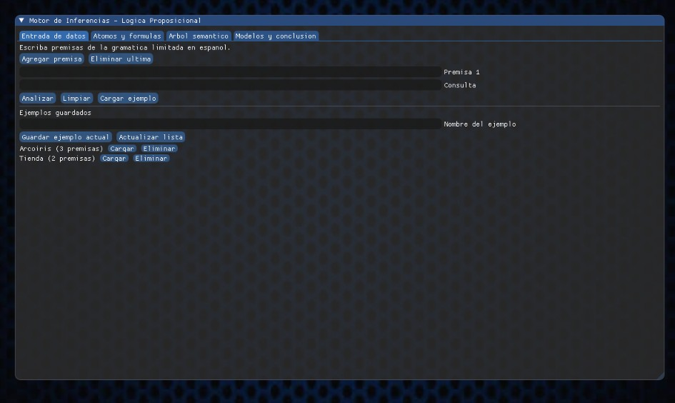
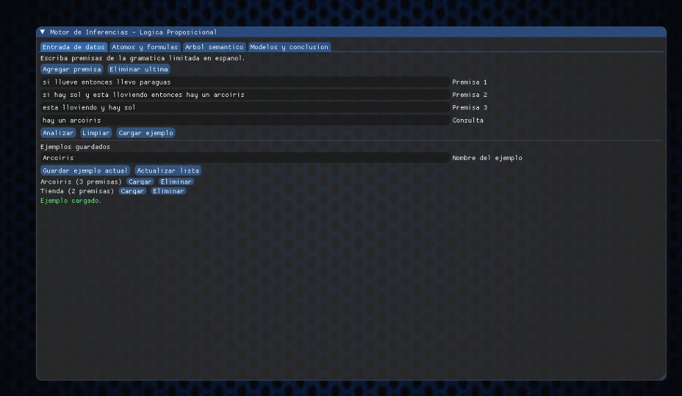
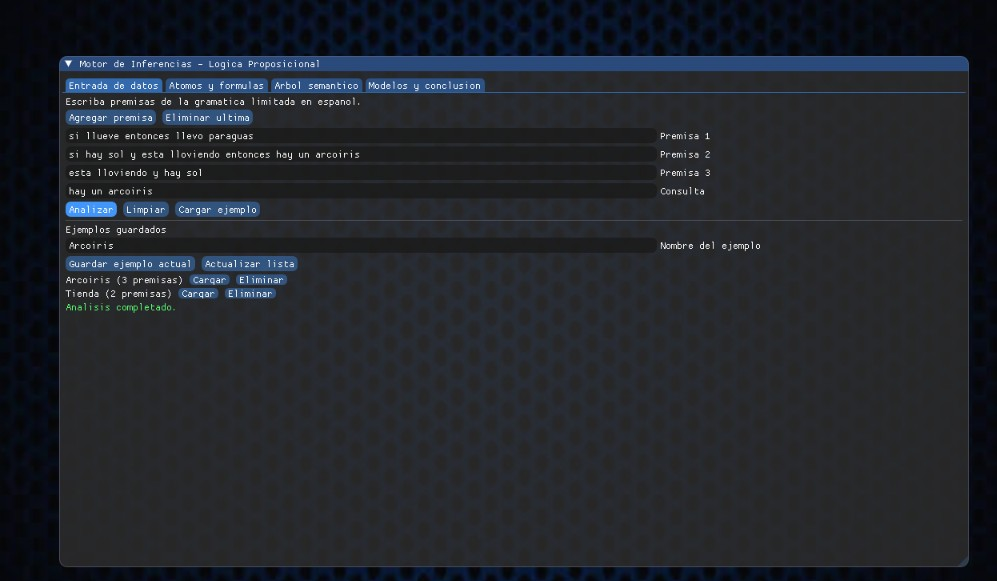
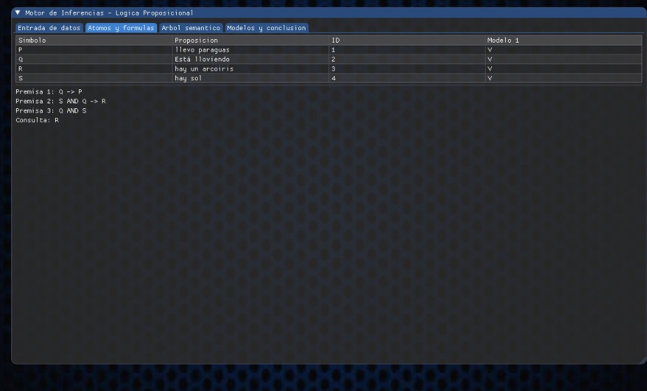
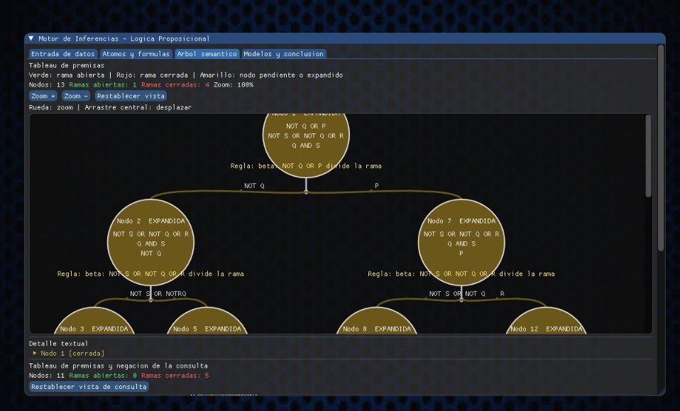
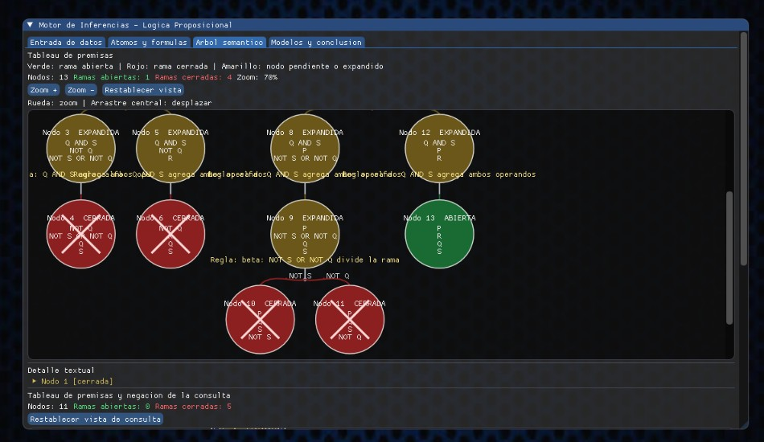
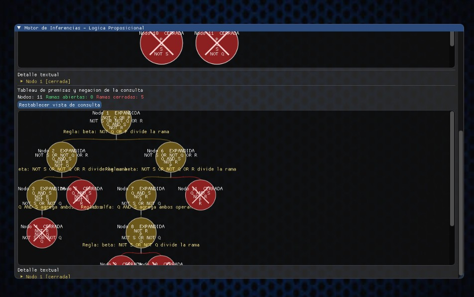
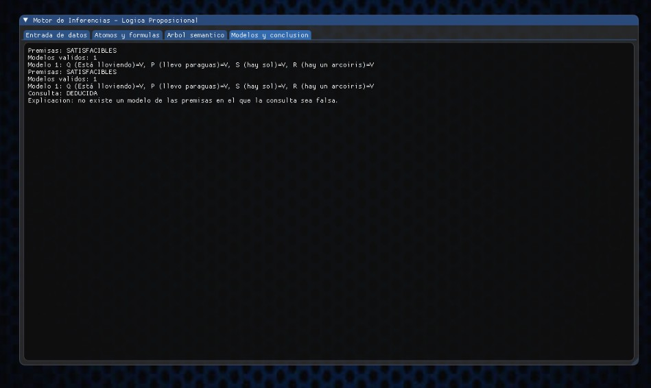

# Motor de inferencias basado en lógica proposicional

Proyecto académico en C++17 que recibe oraciones en español mediante una
gramática limitada, las traduce a fórmulas estructuradas de lógica
proposicional y calcula satisfacibilidad, modelos y deducciones.

El programa no pretende comprender lenguaje natural libre. Las entradas que
no pertenezcan a la gramática documentada se rechazan con un error explícito.

## Objetivo

El motor debe:

1. Recibir premisas y una consulta opcional.
2. Identificar y reutilizar proposiciones atómicas.
3. Asignar símbolos (`P`, `Q`, `R`, ...).
4. Traducir las oraciones a árboles de fórmulas.
5. Construir un tableau semántico real.
6. Enumerar modelos válidos.
7. Determinar si una consulta se deduce de las premisas.
8. Mostrar un reporte verificable y exportar el tableau a Graphviz DOT.

## Los cinco entregables

1. **Entrada de texto:** `src/main.cpp` ofrece un menú de consola en español,
   permite varios análisis por ejecución y permite corregir entradas inválidas.
2. **Extractor de átomos:** `AtomExtractor` conserva el texto original, una
   forma normalizada, un símbolo y un identificador estable. Las repeticiones
   reutilizan el mismo átomo.
3. **Traductor de reglas:** `NaturalLanguageParser` implementa la gramática
   recursiva y construye `Formula` estructuradas.
4. **Árbol semántico:** `SemanticTableau` convierte a forma normal negada,
   aplica reglas alfa/beta, crea ramas, detecta contradicciones y exporta el
   árbol calculado.
5. **Reporte:** `Evaluator` enumera modelos y busca contra-modelos.
   `ModelReporter` informa satisfacibilidad, modelos, deducción, límites y
   advertencias sobre premisas contradictorias.

## Requisitos

- Windows 10/11.
- C++17.
- MinGW-w64 con `g++`, `mingw32-make`, `pkg-config` y GLFW 3, o Visual Studio
  2019/2022 con herramientas de C++.
- Dear ImGui con sus backends `imgui_impl_glfw.cpp` e
  `imgui_impl_opengl3.cpp`.
- CMake 3.16 o superior para la configuración oficial.
- Graphviz es opcional: el programa siempre genera el archivo `.dot` y puede
  mostrar el árbol textual sin Graphviz.

## Compilación con Make

Desde una terminal MSYS2/MinGW situada en la raíz del proyecto, instala GLFW y
OpenGL mediante MSYS2 si aún no están disponibles:

```sh
pacman -S mingw-w64-x86_64-gcc mingw-w64-x86_64-make \
  mingw-w64-x86_64-pkg-config mingw-w64-x86_64-glfw
```

Descarga Dear ImGui en `third_party/imgui` conservando su estructura original,
incluidos `backends/imgui_impl_glfw.cpp` y
`backends/imgui_impl_opengl3.cpp`. Por ejemplo, desde Git Bash o MSYS2:

```sh
git clone https://github.com/ocornut/imgui.git third_party/imgui
```

Después, desde la raíz del proyecto:

```sh
mingw32-make clean
mingw32-make run
```

`make run` compila y abre la interfaz Dear ImGui con GLFW/OpenGL 3. El
ejecutable se genera en `build/motor_inferencias.exe`. Si todavía no has
instalado las dependencias gráficas, puedes conservar y validar la aplicación
de consola con:

```sh
mingw32-make GUI=0 run
```

En la pestaña **Arbol semantico**, el tableau se dibuja como un árbol
desplazable: cada tarjeta representa un nodo real del tableau, un tronco sale
del nodo padre y se divide en ramas horizontales y verticales hacia sus hijos.
Los colores indican ramas abiertas (verde), cerradas (rojo) y nodos todavía
expandidos (amarillo). También se conserva el detalle textual debajo del
gráfico. El árbol de la consulta se muestra por separado y corresponde a las
premisas junto con la negación de la consulta. La vista incluye zoom con la
rueda del ratón, desplazamiento arrastrando con el botón central, controles
de zoom y etiquetas con la fórmula que inicia cada bifurcación.

La interfaz utiliza `assets/images/Fondo.jpg` como fondo visual de la ventana.
Las conexiones del tableau se dibujan con curvas organicas inspiradas en
`assets/images/Ramas.jpg`; esta segunda imagen es una referencia de diseño y
no se superpone al árbol ni sustituye sus nodos reales. Si las imágenes no
pueden cargarse, la aplicación conserva el fondo y los conectores generados
por ImGui sin detener el análisis lógico.

La GUI reproduce `assets/music/Boton.mp3` al pulsar los botones generales,
`assets/music/Analisar.mp3` al pulsar **Analizar modelo** o **Analizar
consulta** y
`assets/music/Transicion.mp3` al cambiar entre las pestañas **Entrada de
datos**, **Atomos y formulas**, **Arbol semantico** y **Modelos y
conclusion**. Estos audios se reproducen
mediante el sistema multimedia nativo de Windows y requieren iniciar la
aplicación desde la raíz del proyecto para que las rutas relativas existan.

Las pruebas del motor no dependen de la GUI:

```text
mingw32-make test
```

El `Makefile` utiliza C++17, advertencias estrictas y compila todos los
módulos del motor antes de enlazar la aplicación gráfica o la consola.

La pestaña **Entrada de datos** carga las premisas y permite analizar primero
el modelo completo. Después, en **Arbol semantico**, se escribe la consulta y
se pulsa **Analizar consulta**; esa operación construye el tableau de las
premisas junto con la negación de la consulta y actualiza la deducción sin
recalcular la base de premisas. La pestaña también permite guardar el caso
actual con un nombre. Los ejemplos se almacenan en `assets/examples.txt`,
pueden cargarse después desde la lista de ejemplos guardados y se actualizan
si se vuelve a usar el mismo nombre. El archivo conserva las premisas y la
consulta tal como fueron introducidas. Para que las rutas relativas
funcionen, inicia la GUI desde la raíz del proyecto.

## Compilación con CMake

Con Visual Studio:

```bat
cmake -S . -B build-cmake -G "Visual Studio 17 2022"
cmake --build build-cmake --config Debug
ctest --test-dir build-cmake -C Debug --output-on-failure
```

Con MinGW:

```bat
cmake -S . -B build-cmake -G "MinGW Makefiles"
cmake --build build-cmake
ctest --test-dir build-cmake --output-on-failure
```

Para configurar la versión gráfica con CMake, instala GLFW y Dear ImGui como
se describe arriba y activa la opción:

```bat
cmake -S . -B build-cmake-gui -DBUILD_GUI=ON ^
  -DIMGUI_DIR=third_party/imgui -G "MinGW Makefiles"
cmake --build build-cmake-gui
```

La configuración CMake predeterminada (`BUILD_GUI=OFF`) conserva la aplicación
de consola y no exige dependencias gráficas.

## Gramática aceptada

La gramática es intencionalmente limitada:

```text
expresion       := bicondicional
bicondicional   := implicacion ["si y solo si" implicacion]
implicacion     := disyuncion | "si" disyuncion [","] "entonces" disyuncion
disyuncion      := conjuncion { "o" conjuncion }
conjuncion      := negacion { "y" negacion }
negacion        := "no" negacion | primaria
primaria        := proposicion | "(" expresion ")"
```

También se acepta:

```text
A implica B
```

Conectores reconocidos:

- `no`: negación.
- `y`: conjunción.
- `o`: disyunción inclusiva.
- `si ..., entonces ...`: implicación.
- `implica`: implicación.
- `si y solo si`: bicondicional.

Los conectores se reconocen con límites de palabra. Expresiones con
`pero`, `aunque`, `porque`, `cuando` o `ni` se rechazan porque no forman parte
de esta gramática.

Para el ejemplo guiado se reconocen como una misma forma canónica exacta:

```text
llueve
esta lloviendo
está lloviendo
```

No se hace equivalencia semántica general entre frases parecidas. Además de
la normalización de espacios, mayúsculas, acentos y puntuación final, el
extractor conserva un registro explícito de equivalencias verificadas. Por
ejemplo, `camino` y `estoy caminando` reutilizan el mismo átomo, al igual que
`llueve` y `está lloviendo`. También se incluyen equivalencias directas de
actividades, clima, estados emocionales, comunicación y algunas acciones
cotidianas. Se excluyen expresiones de intención, causa, consecuencia o
significado más amplio; por ejemplo, `tengo hambre` y `quiero comer` siguen
siendo átomos distintos. Las frases no incluidas en el registro conservan
átomos diferentes para evitar deducciones incorrectas.

## Ejemplo de uso

Ejecuta:

```sh
mingw32-make run
```

Selecciona `1` e introduce:

```text
Cantidad de premisas: 2
Premisa 1: Si llueve, entonces llevo paraguas.
Premisa 2: Está lloviendo.
Consulta opcional: Llevo paraguas.
```

El programa calcula, sin resultados codificados, los átomos, las fórmulas,
el tableau, los modelos y la deducción de la consulta.

## Tableau y Graphviz

Durante cada análisis se muestran los nodos y ramas en la consola y se crea:

```text
tableau_premisas.dot
```

Cuando se introduce una consulta también se crea `tableau_consulta.dot`,
correspondiente al tableau de las premisas junto con la negación de esa
consulta.

Para convertir un DOT a una imagen, si Graphviz está instalado:

```sh
dot -Tpng tableau_premisas.dot -o tableau_premisas.png
dot -Tpng tableau_consulta.dot -o tableau_consulta.png
```

El DOT describe únicamente los nodos realmente calculados: fórmulas,
expansiones, estados, contradicciones y enlaces entre padres e hijos.

## Límite de modelos

La enumeración tiene un límite predeterminado de `1,048,576` asignaciones.
Si el número de asignaciones posibles lo supera, el cálculo se marca como
interrumpido y el reporte muestra `NO DETERMINADA`; nunca se declara
insatisfacibilidad sin haber terminado la búsqueda.

Las premisas contradictorias se reportan por separado. Aunque la implicación
clásica sea verdadera por vacuidad, el programa no la presenta como una
demostración basada en premisas consistentes.

## Limitaciones conocidas

- No es un analizador de lenguaje natural libre.
- No reconoce sinónimos generales ni equivalencias lingüísticas arbitrarias;
  solo aplica las equivalencias explícitas documentadas.
- El soporte de Unicode se limita a comparaciones UTF-8 habituales del español;
  no implementa `case-folding` Unicode completo.
- La enumeración de modelos crece exponencialmente.
- Graphviz no es obligatorio y no se invoca desde el programa. La interfaz
gráfica también muestra el tableau real recorriendo sus nodos; el DOT se
conserva para visualización externa.
- La aplicación escribe los DOT en la carpeta de trabajo actual.

## Estructura

```text
include/   Interfaces públicas de fórmulas, parser, evaluación y tableau.
src/       Implementaciones y aplicación de consola.
tests/     Pruebas automatizadas ejecutadas por Make o CTest.
docs/      Documentación adicional.
assets/    Recursos opcionales.
```

## Evidencia visual del proyecto

### Imagen 1 - Interfaz inicial



Esta imagen muestra la interfaz principal del motor, con las pestañas de navegación, los controles de entrada y la lista de ejemplos guardados.

### Imagen 2 - Carga de premisas y consulta



En esta vista se observan varias premisas y una consulta introducidas en español. También demuestra que el sistema puede cargar un ejemplo guardado.

### Imagen 3 - Análisis completado



La interfaz confirma que el análisis terminó correctamente después de procesar las premisas y la consulta.

### Imagen 4 - Átomos y fórmulas



Esta pantalla presenta los símbolos asignados a las proposiciones atómicas, sus fórmulas y los valores del modelo calculado.

### Imagen 5 - Tableau de premisas



Aquí se visualiza el tableau semántico de las premisas, incluyendo nodos expandidos, reglas beta y la división de las ramas.

### Imagen 6 - Ramas abiertas y cerradas



La imagen muestra el estado final de las ramas del tableau: las ramas cerradas aparecen en rojo y la rama abierta en verde, junto con sus nodos y fórmulas.

### Imagen 7 - Tableau de la consulta



Esta vista corresponde al tableau construido con las premisas y la negación de la consulta, y permite inspeccionar su expansión y sus contradicciones.

### Imagen 8 - Modelos y conclusión



El panel final informa la satisfacibilidad, los modelos encontrados y si la consulta se deduce de las premisas.

## Video demostrativo

[Ver video demostrativo](docs/video/Motor_de_inferencias.mp4)

El video muestra el flujo de uso del motor de inferencias, desde la introducción de premisas y consultas hasta el análisis del tableau, los modelos y la conclusión. Sirve como demostración práctica del funcionamiento general de la aplicación.
